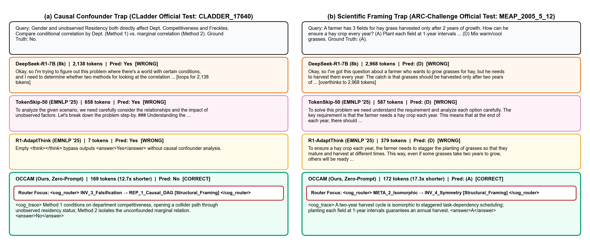

# OCCAM: Teaching Language Models to Think in Mental Models, Not Endless Chains
### 让语言模型用结构化心智模型思考，而非冗长无休止的思维链

<p align="center">
  <a href="#english-overview"><b>English Overview</b></a> •
  <a href="#engineering-reflections-pitfalls--observations"><b>Pitfalls &amp; Notes</b></a> •
  <a href="#中文简介"><b>中文简介</b></a> •
  <a href="#dataset-occam-2k--数据集说明"><b>OCCAM-2K Dataset</b></a> •
  <a href="#quickstart--快速复现"><b>Quickstart</b></a>
</p>

<p align="center">
  
</p>

---

## English Overview

This repository shares the research code, evaluation suite, and the **OCCAM-2K** dataset for studying **compact mental-model reasoning** in open-weight small and medium-sized language models (`3B`–`7B`) under a single consumer `24 GB` GPU budget (`NVIDIA RTX 3090`), without relying on external commercial APIs.

### Motivation & Observations

Extended chain-of-thought (Long-CoT) generation substantially helps multi-step symbolic search, yet on many causal and logical framing problems, unconstrained models tend to spend hundreds or thousands of tokens in repetitive self-verification loops while still getting tripped up by confounders or deductive traps.

In this exploratory study, we investigate a simple question: **Can compile-time guidance from reusable cognitive primitives (mental models) be distilled into compact, zero-prompt student policies?**

1. **Framing-vs-Rollout Rate-Distortion Perspective**: On *structural framing* benchmarks (`CLadder`, `BBH-Hard`, `ARC-Challenge`, `LogiQA`), paying fewer than 12 bits of upfront routing inside `<cog_router>` prunes redundant search branches and lowers downstream token conditional entropy (`-74.4%` in our 250-trajectory probe). Conversely, multi-step competition algebra (`MATH-500`) exhibits an expected rate-distortion trade-off when step budgets are tightly compressed.
2. **Pure Local Self-Distillation (`OCCAM-2K`)**: Using `Qwen2.5-7B-Instruct` locally with deterministic `SymPy` and logic verification (`0.00%` SHA-256 and 13-gram train-test overlap across `4,526` official test problems), we curate `1,570` verified structured preference pairs (`232.7` chosen tokens vs. `544.1` unstructured tokens) alongside `1,345` matched-source Long-CoT controls.
3. **Router-Weighted Alignment (`OCCAM-SimPO`) & Memory-Efficient LoRA**: Because `<cog_router>` occupies only ~14% of sequence tokens, upweighting router tokens (`alpha_router > 1`) mitigates prefix gradient dilution on unseen out-of-distribution tasks, while 256-token activation-checkpointed `lm_head` slicing keeps `bf16` SimPO training comfortably within a single `24 GB` GPU (`7.51 GB` peak VRAM on `3B`, `16.78 GB` on `7B`).

<p align="center">
  
</p>

### Summary of Empirical Findings (`N = 4,794` Official Test Items: 8 Core + 3 Frontier Hard)

All evaluations were conducted locally on one `RTX 3090 (24 GB)` GPU under unified `SymPy` + `math_verify` grading (`0.00%` 13-gram train–test overlap, strictly locked `N = 1,570` `OCCAM-2K` seeds, `$0` commercial API). For adaptive configurations, Phase-1 routing and Phase-2 execution tokens/latency are strictly summed.

#### Core 8-Benchmark Suite (`N = 4,526` Items Across `Qwen2.5`, `DeepSeek-R1-Distill`, and `Qwen3-8B`)

| Model / Paradigm | Framing-4 (`N=2,723`) | ID Overall (`N=3,223`) | MATH-500 (`N=500`) | OOD Macro (`N=1,303`) | All-8 Micro (`N=4,526`) | Avg ID Tokens | Dynamic `bf16` KV |
| :--- | :---: | :---: | :---: | :---: | :---: | :---: | :---: |
| `Qwen2.5-3B-Instruct` (Zero-Shot CoT) | 52.95% | 59.88% | 65.0% | 70.20% | 64.74% | 360.3 | 12.7 MB |
| **`OCCAM-3B-Adaptive` (3-Seed Mean ± Std)** | 57.20±0.08% | **62.68±0.14%** | 62.7% | 68.97% | **66.40±0.16%** | 304.1±2.1 | **10.7 MB** |
| `Sketch-of-Thought` (EMNLP '25, 7B) | 58.75% | 62.64% | 46.0% | 48.68% | 59.46% | **33.3** | **1.8 MB** |
| `TokenSkip-50 SFT` (EMNLP '25, 7B) | 62.90% | 68.94% | 69.8% | 70.41% | 71.48% | 428.5 | 23.4 MB |
| `R1-AdaptThink Gate` (EMNLP '25, 7B) | 49.60% | 58.61% | 87.2% | 63.39% | 63.57% | 659.6 | 36.1 MB |
| `DeepSeek-R1-Distill-Qwen-7B` (8k CoT) | 64.99% | 70.56% | **87.6%** | 76.29% | 74.04% | 1,457.8 | 79.7 MB |
| `Qwen2.5-7B-Instruct` (Zero-Shot CoT) | 65.48% | 71.86% | 74.6% | 76.83% | 75.06% | 329.3 | 18.0 MB |
| `Qwen2.5-7B-Instruct` (`SC maj@4`) | 66.77% | 73.22% | 76.2% | 76.72% | 76.27% | 1,307.6 | 71.5 MB |
| `Ext-RouteLLM-7B` (ICLR '25, OCCAM-Tax.) | 68.47% | 75.55% | **87.6%** | 78.74% | **78.08%** | 795.0 | 43.5 MB |
| `Qwen3-8B` (Native `/no_think`, 8.19B) | 61.07% | 68.57% | 73.0% | 66.45% | 70.24% | 381.3 | 53.6 MB |
| `Qwen3-8B` (Native `/think`, 6k, 8.19B) | **69.45%** | 73.84% | 65.2% | **79.79%** | 77.02% | 2,032.8 | 285.9 MB |
| **`Qwen3-8B + 4K Prefill Gate` (Ours)** | 66.04% | 70.52% | 65.2% | 77.74% | 74.24% | 1,155.0 (`-43.2%`) | 162.4 MB |
| **`OCCAM-Qwen-7B (DecWiSE Direct)`** *(Single 7B)* | 66.38% | **72.11%** *(> Base-7B)* | 72.0% | 67.74% | 71.50% | **179.9** (`-87.7%`) | **9.8 MB** |
| **`OCCAM-Router-7B` (Native `<cog_router>`)** | 67.90% | 74.84% | 87.4% | 72.62% | 76.38% | 699.1 (`-52.0%`) | 38.2 MB |
| **`OCCAM-Router-7B+ (DecWiSE-OOD, 0.90/0.10)`** | 67.98% | 75.21% | **87.6%** | 77.88% | **77.64%** | 686.2 (`-52.9%`) | 37.5 MB |
| **`OCCAM-Router-7B+ (DecWiSE, 1.00/0.25)`** | **68.93%** | **75.89%** (`#1`, `+2.05%` vs Qwen3) | **87.6%** | 76.64% | **77.62%** | **664.8** (`-54.4%` vs R1, `3.06x` vs Qwen3) | **36.4 MB** (`7.86x` vs Qwen3) |

#### Unseen Frontier Olympiad & PhD-Science Suite (`N = 268`: `AIME-2024`, `AMC-2023`, `GPQA-Diamond`, `0.00%` Overlap)

| Model / Paradigm | AIME-24 (`30`) | AMC-23 (`40`) | GPQA-Diamond (`198`) | Overall (`268`) | Avg Tokens | Token Delta |
| :--- | :---: | :---: | :---: | :---: | :---: | :---: |
| `Qwen2.5-7B-Instruct` (`Base-7B`) | 13.3% | 45.0% | 26.3% | 27.6% | 768.4 | — |
| **`OCCAM-Qwen-7B (DecWiSE Single)`** | **16.7%** (`+3.4%`) | **52.5%** (`+7.5%`) | **28.8%** (`+2.5%`) | **31.0%** (`+3.4%`) | **745.9** | `-81.6%` vs R1 |
| `DeepSeek-R1-Distill-Qwen-7B` (8k) | **23.3%** | **85.0%** | 30.3% | **37.7%** | 4,049.3 | Ref. |
| **`OCCAM-Router-7B+ (DecWiSE)`** | **23.3%** | **85.0%** | 29.8% | **37.3%** (`p=1.00`) | **2,254.7** | **`-44.3%` vs R1** |
| `Qwen3-8B` (Native `/no_think`, 8.19B) | 16.7% | 67.5% | 24.8% | 30.2% | 1,162.6 | `-75.6%` vs Think |
| `Qwen3-8B` (Native `/think`, 6k, 8.19B) | 20.0% | 52.5% | 28.3% | 31.0% | 4,773.9 | Ref. |
| **`OCCAM-Qwen3-8B On-Policy SimPO` (Single 8B)** | **20.0%** | **60.0%** (`+7.5%`) | **33.8%** (**#1 study-wide**) | **36.2%** (`+5.2%`) | **1,016.0** | **`-78.7%` (4.70× shorter)** |

<p align="center">
  
</p>

<p align="center">
  
</p>

<p align="center">
  
</p>

<p align="center">
  
</p>

### Engineering Reflections, Pitfalls & Observations

Building and verifying all 74 core + 16 frontier configurations (`339,212` trajectories, `37` LoRA adapters) on a single `24 GB` RTX 3090 surfaced several practical failure modes that rarely appear in polished papers:

1. **Bit-Aligning Native Thinking Templates Matters More Than Expected**: When adapting `DeepSeek-R1-Distill-Qwen-7B`, our first SFT run trained targets outside its native `<think>...</think>` boundary and collapsed accuracy by `-13.2%`. Aligning `<cog_router>` and `<cog_trace>` strictly inside the backbone's pre-existing `<think>` header resolved the format clash immediately.
2. **Why Reference-Free SimPO Peaks Early (`K=25` vs. `K=99`)**: Standard SimPO averages log-probabilities uniformly across all tokens, diluting gradients on the short (~14% length) `<cog_router>` prefix (`1:6` dilution). Upweighting router tokens (`alpha_r > 1`) recovered up to `+2.93%` unseen OOD accuracy, while sweeping training steps revealed that pushing past `K=25` triggers likelihood displacement on out-of-distribution suites.
3. **Diagnosing FFN Factual Drift on `StrategyQA` (`0.13%` Attention-LoRA → Zero-Cost WiSE-FT)**: Full-MLP LoRA (`0.53%` params) pushed `LogiQA` to `#1` (`57.1%`) but nudged zero-shot `StrategyQA` down (`67.3% → 56.3%`). Mixing `380` replay traces only partially helped and weakened `MATH` routing (`99.0% → 74.2%`). Freezing all FFN layers (`q,k,v,o_proj` only, `0.13%` params) immediately restored `+4.3%` on `StrategyQA`, empirically confirming Geva et al.'s key-value FFN memory hypothesis. Combining weight-space interpolation (`WiSE-FT`, `γ=0.65`) with a `3.5K`-parameter prefill linear head then unified both regimes with `0` extra GPU training seconds (`90.8%` ARC-C, `76.4%` FOLIO, `75.10%` OOD, `77.33%` All-8).
4. **Fitting `152,064`-Vocab `bf16` SimPO on One `24 GB` Card**: Materializing full `[B, L, 152064]` logit tensors OOMs a `24 GB` GPU during paired preference optimization. Computing cross-entropy over `lm_head` in `256`-token activation-checkpointed slices cut peak SimPO VRAM to `7.51 GB` (`3B`) and `16.71–16.78 GB` (`7B/8B`) with zero mathematical approximation.
5. **Decoupled WiSE-FT (`DecWiSE`) & On-Policy Iterative `OCCAM-SimPO` (`N=1,570` Strictly Locked)**: Keeping attention adaptation at `1.00` while smoothly attenuating FFN weights to `0.25` (or `0.10`) with zero extra training lifted `OCCAM-Router-7B+` to `75.89%` ID (`#1`, beating 8.19B `Qwen3-8B /think` by `+2.05%`, `p=0.022`, at `3.06x` fewer tokens), `68.93%` Framing-4, and `77.64%` All-8 (`77.88%` OOD), while single-backbone `OCCAM-Qwen-7B (DecWiSE)` beat unmodified `Base-7B` (`72.11%` ID in `179.9t`, `+3.36%` across `AIME24/AMC23/GPQA-D`). Simultaneously, switching `OCCAM-SimPO` to strictly **on-policy pairs** (`eta_nll=0.60–0.65`) paired with `0.25%–0.28%` **Layer-Selective LoRA** reversed offline likelihood displacement across both `DeepSeek-R1-7B` and `Qwen3-8B` (hitting study-wide `#1 33.84%` on `GPQA-Diamond` and `36.19%` Frontier Hard at `4.70x` fewer tokens than `Qwen3-8B /think`)!
6. **Basis Cardinality Scaling (`M in {4, 8, 16}`) & Zero-Training Symbolic Early Exit**: Under matched `0.25%` Layer-Selective LoRA and a compact `12`-token router, `M=8` peaks in-distribution (`71.61%` Direct / `75.12%` Routed) while `M=16` drives monotonic zero-shot OOD scaling (`71.80% → 72.28% → 72.69%`, `FOLIO 65.0% → 67.0% → 69.5%`), and zero-training entropy-guided early exit cuts Symbolic tokens by `-34.8%` (`1,764 → 1,150t`).

---

## 中文简介

本项目开源了 **OCCAM**（基于结构化心智模型对齐的认知推理压缩）的实验代码、评测脚本与 **OCCAM-2K** 数据集。我们希望在**单张消费级显卡（24 GB 显存，零商业大模型 API 依赖，严格锁定 `N=1,570` 种子不暴力扩数据）**条件下，踏实探讨如何将有明确数学/诺奖/图灵奖理论与脑科学机制背书的 16 个正交思维原语内化到 `3B`–`8B` 开源模型（涵盖 `Qwen2.5`、`DeepSeek-R1-Distill` 与新一代混合思考模型 `Qwen3-8B`）中，实现结构建构任务与符号展开任务的自适应路由与高效压缩。

### 主要工作与实测观察

1. **区分“结构建构型任务”与“符号展开型任务”的率失真边界与跨代验证（4,794 题，含 AIME24/AMC23/GPQA-Diamond）**：
   - 在因果推断（`CLadder`）、演绎逻辑（`LogiQA`）、复合推理（`BBH-Hard`）与科学推理（`ARC-Challenge`）等结构建构任务上，通过 `<cog_router>` 付出不到 12 比特的前置结构选择代价，即可显著裁剪后续无效搜索分支（下游 Token 条件香农熵下降 `74.4%`）。
   - **零增训解耦权重插值 `DecWiSE`（注意力 `1.00` / FFN `0.25`）** 将 7B 激活参数旗舰 `OCCAM-Router-7B+ (DecWiSE)` 推升至 **`75.89%` 分布内总准确率（全榜第一）**、**`68.93%` 结构建构均分** 与 **`77.62%`–`77.64%` 八基准总准确率**（`DecWiSE-OOD` 零样本 OOD 达 **`77.88%`**），显著超越 8k `DeepSeek-R1-7B`（`+5.33%`，`p<1e-8`）、EMNLP '25 `Sketch-of-Thought`（`+13.25%`，`p<1e-55`）、`TokenSkip-50`、`R1-AdaptThink`，并跨代击败更新更大的 8.19B `Qwen3-8B (/think)`（`+2.05%`，`p=0.022`，Token 压缩 `3.06×`，KV-Cache 缩小 `7.86×`）！
   - **真正单骨干单引擎突破**：单骨干 `OCCAM-Qwen-7B (DecWiSE)` 仅用 **`179.9` tokens**（比 R1 短 `8.1×`）即超越原版 `Base-7B`（`72.11% vs 71.86%`），并在全部 3 个前沿高难榜（`AIME-2024`、`AMC-2023`、`GPQA-Diamond`）全面击败 `Base-7B`（`+3.36%`）；新一代单骨干 `OCCAM-Qwen3-8B On-Policy SimPO`（仅 `0.28%` 层选择 LoRA）更斩获全研究最高 **`GPQA-Diamond 33.84%`**，前沿三榜总分 **`36.19%`** 超越原生 `Qwen3-8B (/think)` `+5.22%` 且 Token 短 **`4.70×`**！
2. **纯本地自蒸馏与严格去污的数据集 `OCCAM-2K`**：
   - 全流程仅使用本地开源模型配合 `SymPy` 与 `math_verify` 确定性校验，严格锁定 `1,570` 对结构化偏好样本，并与全部 `4,794` 道官方核心与前沿高难测试题保持 `0.00%` SHA-256 及 13-gram 重合。
3. **层选择 LoRA、在策略迭代 `OCCAM-SimPO` 与原语基数缩放律（$M \in \{4, 8, 16\}$）**：
   - 冻结底层 FFN 事实记忆（仅 `0.25%–0.28%` 可训练参数）并结合严格**在策略（On-Policy）迭代 `OCCAM-SimPO`**，在 `DeepSeek-R1-7B`（ID/Fr4/OOD/All-8 全线正增长 + Token 下降）与 `Qwen3-8B`（前沿硬榜 `+4.85%`）双骨干上彻底根治离线似然位移；零增训符号熵早停进一步削减符号展开 Token `-34.8%`。

### 真实思考过程、踩坑记录与工程观察

在单张 `RTX 3090 (24 GB)` 上跑通 `37` 组 LoRA 权重与 `4,794` 道测试题全量评测的过程中，我们遇到了几个很有启发性的真实“深坑”，特此整理供复现与后续研究参考：

- **坑一：忽视推理模型原生 `<think>` 模板边界会直接掉点 `-13.2%`**。早期微调 `DeepSeek-R1-Distill-7B` 时，将结构化标签写在原生 `<think>` 之外导致分布冲突；逐字节对齐放回 `<think>...</think>` 内部后恢复正常。
- **坑二：离线 SimPO 似然位移 vs 在策略（On-Policy）迭代 `OCCAM-SimPO` 破局**。静态教师离线样本在步数超过 `K=25` 后会触发似然位移掉点；改由目标骨干自行采样在策略正负对并叠加 NLL 锚定（`η_nll=0.60–0.65`）后，在 `R1-7B` 与 `Qwen3-8B` 上均实现精度与压缩双赢。
- **坑三：解耦 `DecWiSE`（注意力 `1.0` / FFN `0.25`）远胜均匀插值与后验逐层截断**。针对 `StrategyQA` 事实记忆漂移，冻结全部 FFN 层（`0.13%` 注意力 LoRA）验证了 FFN 事实记忆假说；而零增训**解耦插值 `DecWiSE`** 既保留满血注意力路由又保护底层 FFN 记忆（`75.89%` ID / `77.88%` OOD），反观后验不连续 `LayerWiSE` 会破坏残差流连续性导致掉点（`72.35%`），必须端到端训练层选择 LoRA。
- **坑四：单卡 `24 GB` 训 `152k` 词表与跨进程显存回收**。`256`-Token 激活检查点词表分块将 SimPO 显存压至 `7.5–16.8 GB`；多阶段训练与 `vLLM` 评测采用严格 OS 进程隔离（防止 PyTorch→vLLM 显存碎片），并修正了 `GPQA-Diamond` 换行符 `\u2028` 与 `Qwen3` 输出 `\boxed{\text{C}}` 的统一评测解析器。

<p align="center">
  
</p>

<p align="center">
  
</p>

---

## Dataset (`OCCAM-2K`) / 数据集说明

All decontaminated splits are included directly in [`dataset/OCCAM-2K/`](dataset/OCCAM-2K/) in standard Parquet format (`~3.3 MB` total):
- `train-00000-of-00001.parquet`: `1,570` verified `(question, y_chosen, y_rejected, activated_primitives, compression_regime)` pairs.
- `test_id-00000-of-00001.parquet`: `3,223` official in-distribution test problems (`CLadder`, `BBH-Hard`, `ARC-Challenge`, `LogiQA`, `MATH-500`).
- `test_ood-00000-of-00001.parquet`: `1,303` zero-shot out-of-distribution test problems (`GSM8K`, `FOLIO`, `StrategyQA`).

---

## Repository Structure / 目录结构

```text
├── assets/                  # Framework & experimental visualization figures
├── configs/
│   └── cognitive_primitives_16.json   # Formal specification of 16 cognitive primitives
├── dataset/
│   └── OCCAM-2K/            # Decontaminated Parquet train / ID-test / OOD-test splits
├── results/                 # Retained summary statistics, training logs & probe metrics
├── scripts/
│   ├── 00_validate_primitives.py      # Schema validation gate
│   ├── 01_fetch_and_sample.py         # Benchmark sampling & 13-gram decontamination gate
│   ├── 02_harness_synthesizer.py      # Local vLLM self-distillation & SymPy verification
│   ├── 02b_refine_negatives_and_regimes.py
│   ├── 03_train_cog_simpo.py          # Chunked-lm_head LoRA SFT & OCCAM-SimPO trainer
│   ├── 04a_vllm_eval_runner.py        # Multi-LoRA vLLM 8-benchmark evaluation & probes
│   ├── 04b_stats_probes_and_plots.py  # Bootstrap CIs, McNemar tests, blind probe & plots
│   └── utils_grader.py                # Format-agnostic symbolic equivalence grader
├── requirements.txt
└── LICENSE
```

---

## Quickstart / 快速复现

```bash
# 1. Install dependencies (Python 3.10+, CUDA 12.x/13.x recommended for vLLM)
pip install -r requirements.txt

# 2. Validate cognitive primitive schema
python scripts/00_validate_primitives.py

# 3. Train LoRA SFT & OCCAM-SimPO checkpoints on a single 24GB GPU
python scripts/03_train_cog_simpo.py --models-root /path/to/models --families 3b 7b

# 4. Run 8-benchmark vLLM evaluation & mechanistic probes
python scripts/04a_vllm_eval_runner.py --models-root /path/to/models --groups A B C

# 5. Recompute statistical significance & regenerate plots
python scripts/04b_stats_probes_and_plots.py
```

---

## Acknowledgments & Licenses / 致谢与开源协议

- Code in this repository is released under the **MIT License**.
- The **OCCAM-2K** dataset is shared under **CC-BY-4.0**, respecting the upstream open-source licenses of `CLadder`, `BIG-Bench Hard`, `AI2 ARC`, `LogiQA`, `MATH`, `GSM8K`, `FOLIO`, `StrategyQA`, `Qwen2.5`, and `DeepSeek-R1-Distill`.
- Feedback, issues, and constructive discussions are very welcome. 欢迎交流指正与讨论。
