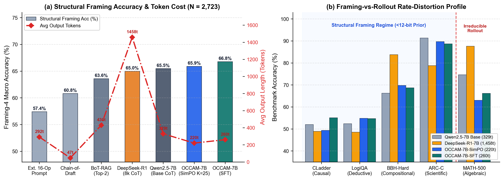
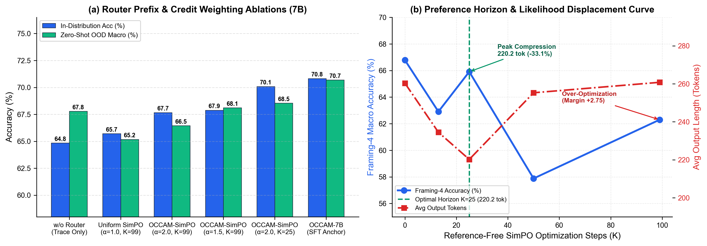

# OCCAM: Teaching Language Models to Think in Mental Models, Not Endless Chains
### 让语言模型用结构化心智模型思考，而非冗长无休止的思维链

<p align="center">
  <a href="#english-overview"><b>English Overview</b></a> •
  <a href="#中文简介"><b>中文简介</b></a> •
  <a href="#dataset-occam-2k--数据集说明"><b>OCCAM-2K Dataset</b></a> •
  <a href="#quickstart--快速复现"><b>Quickstart</b></a>
</p>

<p align="center">
  
</p>

---

## English Overview

This repository shares the research code, evaluation suite, and the **OCCAM-2K** dataset for studying **compact mental-model reasoning** in open-weight small and medium-sized language models (`3B`–`7B`) under a single consumer `24 GB` GPU budget (`NVIDIA RTX 3090`), without relying on external commercial APIs.

### Motivation & Observations

Extended chain-of-thought (Long-CoT) generation substantially helps multi-step symbolic search, yet on many causal and logical framing problems, unconstrained models tend to spend hundreds or thousands of tokens in repetitive self-verification loops while still getting tripped up by confounders or deductive traps.

In this exploratory study, we investigate a simple question: **Can compile-time guidance from reusable cognitive primitives (mental models) be distilled into compact, zero-prompt student policies?**

1. **Framing-vs-Rollout Rate-Distortion Perspective**: On *structural framing* benchmarks (`CLadder`, `BBH-Hard`, `ARC-Challenge`, `LogiQA`), paying fewer than 12 bits of upfront routing inside `<cog_router>` prunes redundant search branches and lowers downstream token conditional entropy (`-74.4%` in our 250-trajectory probe). Conversely, multi-step competition algebra (`MATH-500`) exhibits an expected rate-distortion trade-off when step budgets are tightly compressed.
2. **Pure Local Self-Distillation (`OCCAM-2K`)**: Using `Qwen2.5-7B-Instruct` locally with deterministic `SymPy` and logic verification (`0.00%` SHA-256 and 13-gram train-test overlap across `4,526` official test problems), we curate `1,570` verified structured preference pairs (`232.7` chosen tokens vs. `544.1` unstructured tokens) alongside `1,345` matched-source Long-CoT controls.
3. **Router-Weighted Alignment (`OCCAM-SimPO`) & Memory-Efficient LoRA**: Because `<cog_router>` occupies only ~14% of sequence tokens, upweighting router tokens (`alpha_router > 1`) mitigates prefix gradient dilution on unseen out-of-distribution tasks, while 256-token activation-checkpointed `lm_head` slicing keeps `bf16` SimPO training comfortably within a single `24 GB` GPU (`7.51 GB` peak VRAM on `3B`, `16.78 GB` on `7B`).

<p align="center">
  
</p>

### Summary of Empirical Findings (`N = 4,526` Official Test Items Across 8 Benchmarks)

| Model / Paradigm | Framing-4 Macro (`N=2,723`) | Overall ID (`N=3,223`) | Avg ID Tokens | Dynamic `bf16` KV-Cache | RTX 3090 Speedup vs. R1-7B |
| :--- | :---: | :---: | :---: | :---: | :---: |
| `Qwen2.5-3B-Instruct` (Zero-Shot CoT) | 52.95% | 59.88% | 360.3 | 12.7 MB | 13.5x |
| **`OCCAM-3B-SFT` (Zero-Prompt)** | **58.37%** (`+5.42%`) | **62.43%** (`+2.55%`) | **257.3** (`-28.6%`) | **9.1 MB** | **14.5x** |
| `Chain-of-Draft / Concise-CoT` (7B) | 60.82% | 62.40% | 46.9 | 2.6 MB | 26.8x |
| `External 16-Primitive Prompt` (7B) | 57.41% | 65.56% | 291.7 | 16.0 MB | 4.9x |
| `Buffer of Thoughts RAG` (7B, Top-2) | 63.59% | 70.40% | 429.5 | 23.5 MB | 4.9x |
| `DeepSeek-R1-Distill-Qwen-7B` (8k CoT) | 64.99% | 70.56% | 1,457.8 | 79.7 MB | 1.0x |
| `Qwen2.5-7B-Instruct` (Zero-Shot CoT) | 65.48% | 71.86% | 329.3 | 18.0 MB | 6.9x |
| **`OCCAM-7B-SimPO` (Calibrated `K=25`)** | **65.91%** | **70.09%** | **220.2** (`-84.9%` vs. R1) | **12.0 MB** | **10.0x** |
| **`OCCAM-7B-SFT` (Zero-Prompt)** | **66.78%** | **70.83%** | **260.3** (`-82.1%` vs. R1) | **14.2 MB** | **8.4x** |

<p align="center">
  
</p>

<p align="center">
  
</p>

---

## 中文简介

本项目开源了 **OCCAM**（基于结构化心智模型对齐的认知推理压缩）的实验代码、评测脚本与 **OCCAM-2K** 数据集。我们希望在**单张消费级显卡（24 GB 显存，零商业大模型 API 依赖）**条件下，踏实探讨如何将跨学科经典思维模型（如因果图干预、波普尔证伪、贝叶斯基率校准、逆向目标归约等）内化到 `3B`–`7B` 开源小模型的参数中，从而缓解长思维链（Long-CoT）在因果与逻辑推理中常见的冗余反复（Overthinking）现象。

### 主要工作与观察

1. **区分“结构建构型任务”与“符号展开型任务”的率失真边界**：
   - 在因果推断（`CLadder`）、演绎逻辑（`LogiQA`）、复合推理（`BBH-Hard`）与科学推理（`ARC-Challenge`）等结构建构任务上，通过 `<cog_router>` 付出不到 12 比特的前置结构选择代价，即可显著裁剪后续无效搜索分支（在 250 条测试轨迹探针中，下游 Token 条件香农熵下降 `74.4%`）。
   - 在多步代数竞赛题（`MATH-500`）上，我们也客观记录了强长度压缩下的率失真权衡边界，为后续自适应预算分配提供了参考。
2. **纯本地自蒸馏与严格去污的数据集 `OCCAM-2K`**：
   - 全流程仅使用本地开源模型配合 `SymPy` 符号与逻辑确定性校验，从 1,600 道种子题中合成 1,570 对结构化偏好样本（正样本平均 `232.7` tokens，无结构负样本平均 `544.1` tokens），并与全部 `4,526` 道官方测试题保持 `0.00%` SHA-256 及 13-gram 重合。
3. **显式路由加权对齐（`OCCAM-SimPO`）与单卡显存优化**：
   - 针对简短路由前缀梯度易被长序列稀释的问题，对 `<cog_router>` 赋予更高信用权重，并在无参考模型对齐中结合 256-Token 词表分块激活重计算技术，使 `152k` 大词表模型的 SimPO 训练显存保持在 `7.5–17.8 GB` 以内。

<p align="center">
  
</p>

<p align="center">
  
</p>

---

## Dataset (`OCCAM-2K`) / 数据集说明

All decontaminated splits are included directly in [`dataset/OCCAM-2K/`](dataset/OCCAM-2K/) in standard Parquet format (`~3.3 MB` total):
- `train-00000-of-00001.parquet`: `1,570` verified `(question, y_chosen, y_rejected, activated_primitives, compression_regime)` pairs.
- `test_id-00000-of-00001.parquet`: `3,223` official in-distribution test problems (`CLadder`, `BBH-Hard`, `ARC-Challenge`, `LogiQA`, `MATH-500`).
- `test_ood-00000-of-00001.parquet`: `1,303` zero-shot out-of-distribution test problems (`GSM8K`, `FOLIO`, `StrategyQA`).

---

## Repository Structure / 目录结构

```text
├── assets/                  # Framework & experimental visualization figures
├── configs/
│   └── cognitive_primitives_16.json   # Formal specification of 16 cognitive primitives
├── dataset/
│   └── OCCAM-2K/            # Decontaminated Parquet train / ID-test / OOD-test splits
├── results/                 # Retained summary statistics, training logs & probe metrics
├── scripts/
│   ├── 00_validate_primitives.py      # Schema validation gate
│   ├── 01_fetch_and_sample.py         # Benchmark sampling & 13-gram decontamination gate
│   ├── 02_harness_synthesizer.py      # Local vLLM self-distillation & SymPy verification
│   ├── 02b_refine_negatives_and_regimes.py
│   ├── 03_train_cog_simpo.py          # Chunked-lm_head LoRA SFT & OCCAM-SimPO trainer
│   ├── 04a_vllm_eval_runner.py        # Multi-LoRA vLLM 8-benchmark evaluation & probes
│   ├── 04b_stats_probes_and_plots.py  # Bootstrap CIs, McNemar tests, blind probe & plots
│   └── utils_grader.py                # Format-agnostic symbolic equivalence grader
├── requirements.txt
└── LICENSE
```

---

## Quickstart / 快速复现

```bash
# 1. Install dependencies (Python 3.10+, CUDA 12.x/13.x recommended for vLLM)
pip install -r requirements.txt

# 2. Validate cognitive primitive schema
python scripts/00_validate_primitives.py

# 3. Train LoRA SFT & OCCAM-SimPO checkpoints on a single 24GB GPU
python scripts/03_train_cog_simpo.py --models-root /path/to/models --families 3b 7b

# 4. Run 8-benchmark vLLM evaluation & mechanistic probes
python scripts/04a_vllm_eval_runner.py --models-root /path/to/models --groups A B C

# 5. Recompute statistical significance & regenerate plots
python scripts/04b_stats_probes_and_plots.py
```

---

## Acknowledgments & Licenses / 致谢与开源协议

- Code in this repository is released under the **MIT License**.
- The **OCCAM-2K** dataset is shared under **CC-BY-4.0**, respecting the upstream open-source licenses of `CLadder`, `BIG-Bench Hard`, `AI2 ARC`, `LogiQA`, `MATH`, `GSM8K`, `FOLIO`, `StrategyQA`, `Qwen2.5`, and `DeepSeek-R1-Distill`.
- Feedback, issues, and constructive discussions are very welcome. 欢迎交流指正与讨论。
